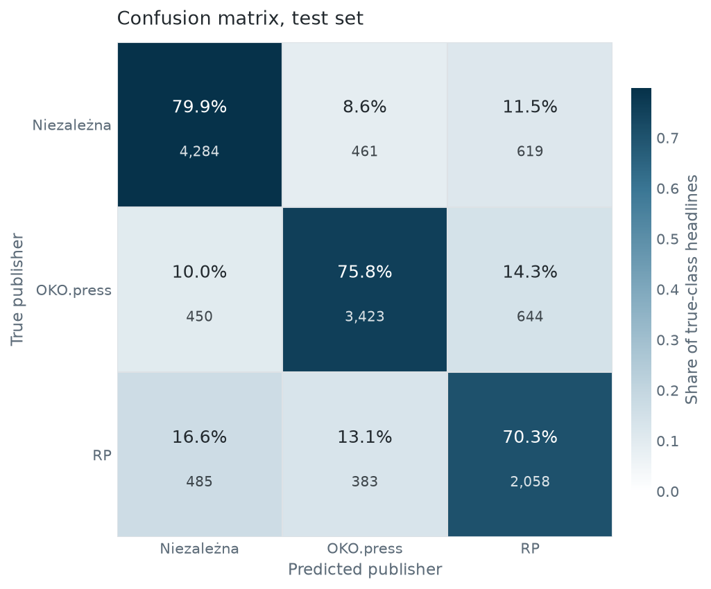

# Klasyfikacja i modelowanie tematyczne nagłówków polskich gazet


Rozpoznawanie wydawcy nagłówka prasowego modelem HerBERT i modelowanie tematów błędów klasyfikatora przez BERTopic, dla trzech tytułów o różnej orientacji politycznej: **Niezależna** (etykieta 0), **OKO.press** (1), **Rzeczpospolita** (2).

Korpus liczy 55 914 nagłówków z okresu 2022-01 - 2026-02, zebranych własnymi scraperami z publicznych archiwów. Dostrojony HerBERT rozpoznaje wydawcę z F1-macro 0,749 na zbiorze testowym, wobec 0,671 dla TF-IDF z regresją logistyczną. Nagłówki sklasyfikowane błędnie grupują się tematycznie, co wskazuje obszary, w których języki trzech tytułów zbliżają się do siebie.

Pytanie badawcze jest takie: na ile tytuły o różnej orientacji politycznej da się od siebie odróżnić po samym nagłówku, czyli po kilkunastu słowach, i w jakich tematach ta różnica zanika.

## Hipotezy

Badanie testuje dwie hipotezy.

- **H1 (odróżnialność).** Dostrojony model transformerowy przypisuje nagłówki do wydawców trafniej niż klasa większościowa, reprezentacja leksykalna i niedostrojone embeddingi. Potwierdzona: F1-macro 0,749 na teście wobec 0,688 dla zamrożonego HerBERTa, 0,671 dla TF-IDF z regresją logistyczną i 0,197 dla klasy większościowej.
- **H2 (zbieżność narracji).** Nagłówki sklasyfikowane błędnie nie są szumem losowym, lecz skupiają się w rozpoznawalnych grupach tematycznych. Zgodna z obserwacją: model tematyczny wyodrębnił 14 tematów skupionych wokół krajowego sporu politycznego i spraw międzynarodowych. Etap jest eksploracyjny i nie testuje nielosowości formalnie, a 59,0% pomyłek nie trafiło do żadnego tematu.

## Wyniki

Wartości w tabelach poniżej pochodzą z jednego pliku predykcji i odtwarza je `notebooks/04_tabele_i_rysunki.ipynb`. Wyjątek dotyczy modelu tematycznego i jest opisany niżej.

| Model | F1-macro (walidacja) | F1-macro (test) |
|---|---|---|
| Klasa większościowa | 0,175 | 0,197 |
| TF-IDF + regresja logistyczna | 0,662 | 0,671 |
| TF-IDF + liniowy SVM | 0,643 | 0,647 |
| HerBERT bez dostrojenia | 0,688 | 0,688 |
| HerBERT dostrojony | 0,764 | 0,749 |

Przewaga modelu kontekstowego nad reprezentacją TF-IDF wynosi 0,073 F1-macro na teście, z czego 0,017 daje sama reprezentacja HerBERTa bez dostrojenia, a 0,056 dostrojenie wag enkodera. Zadanie daje się więc w znacznej części rozwiązać cechami leksykalnymi, a dostrojenie dokłada poprawę umiarkowaną. Punktów odniesienia nie strojono, więc podana przewaga jest raczej górnym oszacowaniem.



Najtrudniejszy do rozpoznania jest tytuł centrowy. RP ma czułość 0,703 przy precyzji 0,620, a model przypisuje do tej klasy 3321 nagłówków wobec jej rzeczywistej liczebności 2926. Pomyłki między dwiema stronami sporu są rzadsze niż pomyłki każdej z nich ze środkiem: 911 nagłówków wobec 1104 i 1027.

Obserwacja opisuje rozkład błędów i nie rozstrzyga, czy wynika on z podobieństwa językowego tytułu centrowego do obu stron, czy z jego mniejszej liczebności i spadku udziału w okresie testowym (22,8% wobec 30,5% w zbiorze uczącym).

Model tematyczny wyodrębnił 14 tematów przy udziale obserwacji odstających 59,0% i spójności NPMI -0,101. Największe skupiska dotyczą krajowego sporu politycznego i spraw międzynarodowych. Spójność jest niska, więc tematy opisują zgrubne skupiska, nie rozłączne kategorie. Zestawienie z kierunkami pomyłek: [outputs/tabela_tematy_bledow.md](outputs/tabela_tematy_bledow.md).

Model zbudowano na tych samych 3042 nagłówkach błędnie sklasyfikowanych, które daje plik predykcji z tabeli wyżej, więc liczebności tematów opisują ten sam przebieg. Temat dostało 1247 z nich, czyli 41,0%; pozostałe są obserwacjami odstającymi i nie wchodzą do analizy tematycznej.

## Przepływ danych

```
data/korpus_surowy.csv                          korpus surowy ze scraperów
        │
        │  src.data.prepare_splits        czyszczenie + PODZIAŁ CHRONOLOGICZNY
        ▼
data/train_data.csv · valid_data.csv · test_data.csv · split_info.json
        │                                 test = ostatni rok, valid = przedostatni
        │
        ├──────────►  notebooks/01a_herbert_optuna.ipynb          (GPU)
        │                 → herbert_best_model/ , herbert_optuna.db
        │                 → data/dane_z_prawdopodobienstwem.csv   predykcje
        │
        └──────────►  notebooks/01b_bertopic_tuning.ipynb         (GPU)
                          → best_bertopic_model/ (+ _reduced, _merged)
                                  │
   dane_z_prawdopodobienstwem.csv + modele tematyczne
                                  │
        ┌─────────────────────────┼──────────────────────────┐
        ▼                         ▼                          ▼
  notebooks/02_...        notebooks/03_...            notebooks/04_...
  tematy i błędy          model tematyczny na          tabele i rysunki
  w czasie                pomyłkach                    → outputs/figures/
```

Podział jest **chronologiczny**: test to ostatni rok, walidacja przedostatni, trening cała wcześniejsza część. Zapobiega to wyciekowi informacji z przyszłości, ale sprawia, że część różnicy między walidacją a testem może wynikać ze zmiany tematyki w czasie.

## Przebieg badania

Każdy etap opisany jest tak samo: co się dzieje, dlaczego tak, i co by się stało przy innej decyzji.

### 0. Korpus, czyszczenie, podział

Korpus surowy liczy 88 070 nagłówków z okresu 2010-08 - 2026-02. Do próby analitycznej wchodzi 55 914 po odrzuceniu 264 rekordów bez dającej się sparsować daty i 31 892 sprzed 2022 roku. Dolna granica nie jest wyborem metodologicznym, tylko ograniczeniem danych: archiwum OKO.press zaczyna się w 2022 roku, a bez jednego z trzech tytułów zadanie klasyfikacji traci sens.

Dopiski redakcyjne w nawiasach kwadratowych usunięto, bo występowały skrajnie asymetrycznie: 12,8% nagłówków OKO.press, 5,8% Niezależnej i 0,5% RP. Zostawione, stałyby się znacznikiem wydawcy zamiast jego orientacji - model uczyłby się rozpoznawać konwencję redakcyjną, a nie język.

Lematyzacja Morfeuszem 2 obejmuje cały korpus, ale służy wyłącznie do liczenia spójności tematycznej. Klasyfikator i embeddingi BERTopic pracują na tekście surowym, bo wielkość liter, słowa funkcyjne i interpunkcja niosą część stylu, którą lematyzacja by zatarła.

Podział jest chronologiczny: test to ostatni rok korpusu, walidacja przedostatni, trening cała wcześniejsza część. Granice wyznacza data, nie udział obserwacji. Podział losowy wpuściłby do zbioru uczącego nagłówki późniejsze niż oceniane, czyli wyciek informacji z przyszłości; ceną jest to, że część różnicy między walidacją a testem może pochodzić ze zmiany tematyki w czasie, nie ze słabszego uogólniania. Gwarancji pilnują testy w `tests/`.

### 1a. Klasyfikator

Kryterium strojenia i raportowania jest F1-macro, nie trafność. Klasy są nierówne (37,4 / 35,4 / 27,3%), więc trafność nagradzałaby przewidywanie klasy najliczniejszej.

Wagi klas liczone są wyłącznie na zbiorze treningowym. Policzenie ich na całości przeniosłoby do uczenia informację o rozkładzie klas w teście - rozkład, który właśnie się zmienia, bo udział RP spada z 30,5% w treningu do 22,8% w teście.

Funkcję straty rozszerzono o trzy mechanizmy i każdy adresuje co innego: wagi klas metodą `balanced` wyrównują wkład klas nierównych, focal loss tłumi wkład przykładów łatwych i przesuwa uczenie na trudne, a wygładzanie etykiet ogranicza nadmierną pewność modelu. Dodatkowo tempo uczenia maleje w głąb sieci, a najniższe warstwy można zamrozić - oba mechanizmy ograniczają zapominanie wiedzy z pretreningu, co przy 27 tysiącach krótkich tekstów jest realnym ryzykiem.

Wielkość wsadu utrzymywana jest akumulacją gradientu na stałym poziomie 32. Dzięki temu efektywny wsad nie zależy od tego, ile mieści się w pamięci karty, więc wynik strojenia nie jest związany ze sprzętem.

Strojenie prowadzi Optuna z samplerem TPE i medianowym przycinaniem prób. Przycinanie jest konieczne, nie kosmetyczne: z 500 prób w bazie 460 przerwano, a pełny trening każdej z nich trwałby godziny.

Punktów odniesienia są cztery i każdy odpowiada na inne pytanie. Klasa większościowa wyznacza dolną granicę. TF-IDF z regresją logistyczną i z liniowym SVM mówią, jaka część zadania daje się rozwiązać cechami leksykalnymi. HerBERT bez dostrojenia, czyli ten sam enkoder z zamrożonymi wagami, rozdziela przewagę modelu kontekstowego na część wnoszoną przez samą reprezentację (0,017 F1-macro nad TF-IDF) i część wnoszoną przez dostrojenie (0,056).

Reprezentacją nagłówka w tym ostatnim jest średnia stanów tokenów ważona maską uwagi, nie stan tokena `[CLS]`. Surowy BERT nie był uczony tak, by `[CLS]` niósł reprezentację zdania, więc odczyt z niego zaniżyłby ten punkt odniesienia i zawyżył przewagę dostrojenia. Punktów odniesienia nie strojono, więc podana przewaga jest raczej górnym oszacowaniem.

### 1b. Model tematyczny na korpusie

Embeddingi liczone są raz, przed strojeniem, i podawane do każdej próby. Liczenie ich w pętli byłoby najdroższą częścią przebiegu, a wynik nie zależy od strojonych parametrów, bo te dotyczą dopiero redukcji wymiaru i klastrowania.

Strojenie obejmuje 500 prób, a przestrzeń przeszukiwania opisuje `PRZESTRZEN_KORPUS` w `src/topics.py`. Funkcją celu jest samo NPMI. Udział obserwacji odstających zapisywany jest przy każdej próbie, ale do celu nie wchodzi: karanie za odstające popycha HDBSCAN do wciągania do tematów nagłówków, które do nich nie należą, czyli kupuje pokrycie kosztem tego, co miara spójności ma mierzyć.

Filtry `min_df` i `max_df` nakładane są dopiero po wyznaczeniu tematów, przez `update_topics`. Nałożone od razu odrzuciłyby część słownika jeszcze przed klastrowaniem, a przy ostrym progu wektoryzator kończy się błędem na pustym słowniku. Kolejność jest ta sama w funkcji celu i przy modelu finalnym, więc model powstaje w warunkach, w których był oceniany.

Raportowane są trzy miary spójności, UMass, UCI i NPMI, mimo że optymalizowana jest jedna. Miary spójności nie zgadzają się ze sobą i zależą od sformułowania, więc podanie jednej ukrywałoby tę niepewność. Liczy je jeden kod dla BERTopica, LDA i NMF, na tym samym korpusie referencyjnym; bez tego porównanie modeli mierzyłoby różnicę implementacji, nie modeli.

Redukcja obserwacji odstających podnosi pokrycie korpusu kosztem spójności, a w tym przebiegu kosztuje ją w całości: udział odstających spada z 72,6% do 0,06%, ale NPMI schodzi z 0,201 do -0,021, czyli do poziomu, przy którym czołowe słowa tematów współwystępują nie częściej niż przypadkowo. Zabieg nie usuwa nagłówków, tylko przypisuje każdy z nich do najbliższego tematu według c-TF-IDF, więc przy trzech czwartych odstających wpycha większość korpusu do tematów zdefiniowanych przez pozostałą jedną czwartą.

Tabela przed i po jest więc diagnozą, nie wyborem modelu. Model zredukowany zapisywany jest osobno do `models/best_bertopic_model_reduced` i żaden dalszy etap go nie wczytuje: `load_saved_model` sięga po model scalony albo podstawowy, a `hard_error_stats` i `soft_error_stats` odfiltrowują nagłówki odstające. Obserwacje odstające zostają więc odstającymi, a ich udział jest wynikiem podawanym obok spójności, nie usterką do zamaskowania.

Scalanie hierarchiczne łączy tematy drobne i częściowo pokrywające się treścią. Poziom wybiera suma trzech miar przeskalowanych min-max, bo same miary mają różne zakresy i nie dają się dodać wprost. Kryterium jest jawne, a poziom można też wskazać ręcznie.

### 2. Błędy w czasie

Pojedynczy temat w pojedynczym miesiącu zbiera na tyle mało nagłówków, że szereg twardych pomyłek skacze między zerem a kilkoma zdarzeniami i nie daje się odczytać jako przebieg. Wkład nagłówka liczy się więc jako P(błąd) = 1 - P(klasa prawdziwa), a suma po nagłówkach miesiąca daje oczekiwaną liczbę błędów, zmieniającą się płynnie.

Miara opisuje niepewność klasyfikatora wobec nagłówka i nie rozstrzyga, czy nagłówek został przypisany błędnie - to pokazuje osobna tabela twardych pomyłek. Grupy poniżej 10 nagłówków są odrzucane, bo udział policzony na kilku obserwacjach nie niesie informacji.

### 3. Analiza pomyłek

Pomyłki opisane są dwiema drogami, które odpowiadają na różne pytania. Przypisanie im tematów z modelu zbudowanego na całym korpusie mówi, w których obszarach treści model się myli. Zbudowanie modelu tematycznego od nowa, wyłącznie na błędnie sklasyfikowanych nagłówkach testowych i na embeddingach z dostrojonego enkodera, mówi, czy same pomyłki mają własną strukturę tematyczną. Drugi model ma węższą przestrzeń przeszukiwania, opisaną przez `PRZESTRZEN_POMYLKI`, bo podzbiór jest o rząd wielkości mniejszy od korpusu; strojenie obejmuje tyle samo prób, czyli 500. Temat dostaje 1247 z 3042 pomyłek, czyli 41,0%.

Słownictwo pomyłek liczone jest w oknach półrocznych wyznaczanych numerem miesiąca, a nie przez `to_period`: mnożnik przy częstości miesięcznej nie skleja miesięcy w jeden okres, więc grupowanie wychodziło miesięczne mimo zadanej długości okna. Okna poniżej 15 nagłówków są pomijane, bo ranking liczony na kilkunastu dokumentach jest przypadkowy.

### 4. Tabele i rysunki

Wszystkie tabele, liczba błędów przekazana do modelu tematycznego i macierze pomyłek powstają z jednego pliku predykcji, w jednym wywołaniu. Bez tego liczby w sąsiadujących tabelach pochodzą z różnych przebiegów i rozjeżdżają się o kilka tysięcznych.

## Dane

Dane pochodzą z własnych scraperów i nie są dołączone do repozytorium ze względu na rozmiar. Przechowywane są wyłącznie metadane publiczne: tekst nagłówka, data publikacji i identyfikator wydawcy. Treści artykułów ani danych osobowych nie zapisywano.

Korpus surowy liczy 88 070 rekordów z okresu 2010-08 - 2026-02, próba analityczna 55 914 z okresu 2022-01 - 2026-02. Czyszczenie, ubytek rekordów i rola lematyzacji opisane są w sekcji [Przebieg badania](#0-korpus-czyszczenie-podział).

| Wydawca | Orientacja | Etykieta | Liczba | Udział |
|---|---|---|---|---|
| Niezależna | prawicowa | 0 | 20 892 | 37,4% |
| OKO.press | liberalno-lewicowa | 1 | 19 781 | 35,4% |
| RP | centrowa | 2 | 15 241 | 27,3% |

Liczebności w podzbiorach oraz średnią długość nagłówka w słowach i w tokenach BPE liczy `src.data.descriptive_stats`; wyniki trafiają do `outputs/tabela_opis_korpusu.csv`, a rozbicie ubytku rekordów do `outputs/tabela_ubytek_czyszczenie.csv`. Nagłówek ma średnio 11,4 słowa i 17,5 tokena BPE, przy czym Niezależna pisze najdłużej (12,5 słowa), a RP najkrócej (10,2).

## Ograniczenia

- Każdą orientację reprezentuje jeden tytuł, więc model nie oddziela orientacji politycznej od stylu konkretnej redakcji. Wyniki opisują odróżnialność tytułów, zgodną z odróżnialnością ideologiczną, ale nie równoważną jej.
- Analiza tematyczna jest eksploracyjna i nie porównuje się z nagłówkami sklasyfikowanymi poprawnie, więc mówi, gdzie błędy się skupiają, a nie czy ich rozkład różni się od rozkładu całego korpusu. 59,0% pomyłek nie trafiło do żadnego tematu.
- Wysokiego udziału obserwacji odstających nie zbija sam próg wielkości skupiska. We wszystkich 481 użytecznych próbach strojenia na korpusie udział mieści się w przedziale 65,0-77,7%, a zależność od `min_cluster_size` jest płytka: przy progu 60-80 mediana wynosi 72,0%, przy 80-100 jest to 74,1%, przy 100-120 zaś 74,9%, przy korelacji +0,45. Dwukrotne zmniejszenie progu zbija udział o niecałe trzy punkty. Przestrzeń przeszukiwania zaczyna się jednak od 60, więc wniosek, że pokrycie ogranicza materiał, a nie przestrzeń przeszukiwania, pozostaje poniżej tej granicy ekstrapolacją. Zestawienie liczy `topics.outlier_share_by_cluster_size` wprost z bazy prób; próby o liczbie tematów poniżej progu `MIN_TOPICS` odrzuca funkcja celu i nie wchodzą do zestawienia, co odejmuje 16 z 497 prób ukończonych.
- Część nagłówków, zwłaszcza opartych na depeszach agencyjnych, bywa niemal identyczna między tytułami i jest nieprzypisywalna z zasady.
- Punktów odniesienia nie strojono i nie podano oszacowań niepewności dla różnic między modelami.
- Korpus zebrano jednorazowo i od tego czasu scraperów nie uruchamiano. `00a_scraping.ipynb` dokumentuje metodę pobrania, nie jest natomiast krokiem odtwarzającym dane: serwisy zmieniają układ stron, więc selektory mogą już nie pasować. Punktem wejścia potoku jest `data/korpus_surowy.csv`.
- Kroku scalającego wyniki scraperów w `data/korpus_surowy.csv` nie ma w repozytorium. Zawartość korpusu jest udokumentowana, sam krok wykonano doraźnie.

## Instalacja

Trening wymaga karty z CUDA, więc build GPU instaluje się przed resztą zależności:

```bash
python -m venv venv312
venv312/Scripts/activate
pip install torch==2.6.0 --index-url https://download.pytorch.org/whl/cu124
pip install -r requirements.txt
```

Sam `pip install -r requirements.txt` zainstaluje build CPU, na którym trening i liczenie embeddingów nie ruszą. Sprawdzenie: `python -c "import torch; print(torch.cuda.is_available())"`.

## Kolejność uruchamiania

| Krok | Notebook | Funkcja z `src/` | Koszt |
|---|---|---|---|
| scraping (dokumentacja metody) | `00a_scraping.ipynb` | `src.scraping.scrape_sources`, `scrape_okopress` | nie uruchamiany |
| 0. Dane i EDA | `00_korpus_i_eda.ipynb` | `src.data.prepare_splits`, `descriptive_stats` | minuty (lematyzacja) |
| 1a. HerBERT | `01a_herbert_optuna.ipynb` | `src.classifier.tune_hyperparameters`, `train_final_model`, `predict_splits` | godziny, GPU |
| 1b. BERTopic | `01b_bertopic_tuning.ipynb` | `src.topics.make_objective`, `build_final_model`, `merge_level_search`, `apply_merge_level` | godziny, GPU |
| 2. Analiza czasowa | `02_topic_model_time_series_analysis.ipynb` | `src.evaluation.build_error_time_series` | minuty, GPU |
| 3. Analiza błędów | `03_misclassified_headlines_analysis.ipynb` | `src.evaluation.keywords_by_period`, `confidence_over_time`, `src.topics.build_misclassified_topics` | godziny, GPU |
| 4. Tabele i rysunki | `04_tabele_i_rysunki.ipynb` | `src.evaluation.build_article_tables` | około 90 s, potem 30 s |

Każdy etap ma tę samą postać: definicja procesu jest funkcją w `src/`, notebook ją wywołuje i pokazuje wyniki. W `src/` nie ma `main()` ani wejść z linii poleceń - wszystko uruchamia się z notebooka.

## Testy

Testy sprawdzają gwarancje metodologiczne, od których zależą wnioski: brak wycieku informacji z przyszłości przy podziale chronologicznym, rozłączność podzbiorów, to, że czyszczenie nagłówków nie usuwa treści, oraz to, że nagłówek złożony z samych dopisków nie ginie w potoku. Jest ich 11, działają na próbie syntetycznej, więc nie wymagają korpusu ani GPU i wykonują się w 0,7 s.

```bash
pip install -r requirements-dev.txt
pytest
```

`pytest.ini` ustawia korzeń projektu na ścieżce importu i katalog `tests`, więc wywołanie działa niezależnie od tego, czy testy uruchamia `pytest`, czy `python -m pytest`. Ten sam zestaw wykonuje się w CI na Pythonie 3.12 i 3.14.

Testy zweryfikowano mutacyjnie, na kopii projektu. Podmiana podziału chronologicznego na losowy zapala 3 testy, nałożenie okien TRAIN i VALID na siebie 2. Czyszczenie nagłówków chronione jest w obie strony: wyłączenie usuwania dopisków zapala 3 testy, czyszczenie zjadające prefiks treściowy 1. Usunięcie zabezpieczenia, które przywraca oryginał po opróżnieniu nagłówka, zapala 1 test.

## Struktura projektu

```
.
├── config.py                      # wszystkie ścieżki i stałe (edytuj tutaj)
├── requirements.txt               # zależności z przypiętymi wersjami
├── requirements-dev.txt           # zależności testowe
├── pytest.ini                     # korzeń na ścieżce importu, katalog testów
├── LICENSE                        # MIT, obejmuje wyłącznie kod
├── .github/workflows/testy.yml    # testy na Pythonie 3.12 i 3.14
├── src/                           # logika w funkcjach
│   ├── utils.py                   # helpery: spójność, podział, czyszczenie nagłówków
│   ├── data.py                    # wczytanie, czyszczenie, podział chronologiczny
│   ├── classifier.py              # HerBERT: strojenie, trening, predykcje, punkty odniesienia
│   ├── topics.py                  # BERTopic: funkcje celu Optuny, LDA/NMF
│   ├── evaluation.py              # tabele metryk
│   ├── plot_style.py              # system wizualny: tokeny barw i proporcje
│   ├── visualization.py           # rysunki
│   └── scraping/                  # scrapery (async HTML + JSON)
├── notebooks/                     # drivery: import z src/, wyniki i wykresy
├── data/                          # dane (duże pliki poza repozytorium)
├── models/                        # modele i bazy Optuny (poza repozytorium)
├── outputs/                       # wszystko wygenerowane: tabele i figures/
└── tests/                         # testy gwarancji metodologicznych
```

Notebooki pełnią rolę driverów: importują funkcje z `src/` i pokazują wyniki. Każdy zaczyna się komórką dodającą katalog projektu do `sys.path`, dzięki czemu `import config` działa mimo położenia w `notebooks/`.

Wszystkie ścieżki pochodzą ze stałych w `config.py`. Nie wpisuj ścieżek na sztywno: przeniesienie katalogu z modelami ma być zmianą jednej linii.

| Stała | Znaczenie |
|---|---|
| `DATA`, `MODELS`, `OUTPUTS_DIR`, `FIGURES` | katalogi; tworzone przy imporcie, jeśli nie istnieją |
| `RAW_CSV` | korpus surowy ze scraperów, wejście etapu 0 |
| `TRAIN_CSV`, `VALID_CSV`, `TEST_CSV`, `SPLIT_INFO` | podzbiory i metadane podziału |
| `PROBS_CSV` | predykcje i prawdopodobieństwa, wspólne źródło wszystkich liczb |
| `OKO_CSV`, `NEWSPAPERS_CSV` | wyniki obu scraperów |
| `HERBERT_DIR` | dostrojony klasyfikator |
| `BERTOPIC_DIR`, `BERTOPIC_REDUCED`, `BERTOPIC_MERGED` | model tematyczny na całym korpusie: podstawowy, po redukcji odstających i scalony |
| `MISCLASSIFIED_DIR` | model tematyczny na samych pomyłkach |
| `HERBERT_OPTUNA_DB`, `BERTOPIC_OPTUNA_DB`, `MISCLASSIFIED_OPTUNA_DB` | bazy prób Optuny (SQLite), po jednej na każde z trzech strojeń |
| `RANDOM_SEED` | ziarno 42, używane przez UMAP i HDBSCAN |
| `GAZETY` | mapowanie etykiety na nazwę wydawcy |
| `HERBERT_MODEL`, `MAX_LENGTH` | model bazowy `allegro/herbert-base-cased` i długość tokenizacji 128 |
| `DATA_START`, `VALID_YEARS`, `TEST_YEARS` | dolna granica korpusu i długość obu okien podziału |
| `EXTRA_STOPWORDS` | polskie słowa funkcyjne odsiewane przy liczeniu spójności |

Katalog `models/` jest wykluczony z repozytorium i odtwarza się z notebooków `01a` oraz `01b`. Zajmuje około 500 MB, z czego 480 MB to sam dostrojony HerBERT. Trening zapisuje checkpointy co epokę; `save_total_limit=1` ogranicza je do jednego, bo po treningu używany jest wyłącznie model najlepszy.

## Co powstaje

Każdy plik w `outputs/` i `data/` ma funkcję, która go zapisuje. Katalogi `data/`, `models/` i duże pliki pośrednie są wykluczone z repozytorium, ale odtwarzają się z notebooków.

| Plik | Wytwarza | Etap |
|---|---|---|
| `data/train_data.csv`, `valid_data.csv`, `test_data.csv`, `split_info.json` | `data.save_splits` | 0 |
| `outputs/tabela_opis_korpusu.csv`, `tabela_ubytek_czyszczenie.csv` | `data.descriptive_stats` | 0 |
| `outputs/figures/05_liczebnosci_miesieczne.png` | `visualization.plot_monthly_counts` | 0 |
| `data/herbert_optuna_best_params.json`, `herbert_optuna_all_trials.csv` | `classifier.tune_hyperparameters` | 1a |
| `models/herbert_best_model/` | `classifier.train_final_model` | 1a |
| `data/dane_z_prawdopodobienstwem.csv` | `classifier.predict_splits` | 1a |
| `data/frozen_herbert_embeddings.npy` | `classifier.frozen_embeddings` (pamięć podręczna) | 1a lub 4 |
| `data/bertopic_optuna_best_params.json` | `topics.best_params_from_study` | 1b |
| `models/best_bertopic_model/`, `data/representative_docs.pkl` | `topics.build_final_model` | 1b |
| `models/best_bertopic_model_reduced/` | notebook `01b` po `topics.reduce_outliers_compare` | 1b |
| `outputs/merger_optimisation_results.pkl` | `topics.merge_level_search` | 1b |
| `models/bertopic_model_merged/` | `topics.apply_merge_level` | 1b |
| `outputs/figures/09_spojnosc_poziomow_scalania.png` | `visualization.plot_merge_levels` | 1b |
| `data/valid_data_with_topics.csv` | `topics.assign_topics` (pamięć podręczna) | 2 |
| `data/dane_zle_sklasyfikowane_statystyki.csv` | `evaluation.hard_error_stats` | 2 |
| `data/dane_wygladzone_miekkie.csv` | `evaluation.soft_error_stats` | 2 |
| `outputs/figures/04_bledy_wedlug_tematu_w_czasie.png` | `visualization.plot_topic_error_series` | 2 |
| `outputs/figures/06_profil_prawdopodobienstw.png` | `visualization.plot_probability_profile` | 3 |
| `outputs/figures/07_entropia_w_czasie.png`, `08_pewnosc_w_czasie.png` | `visualization.plot_metric_over_time` | 3 |
| `models/misclassified_topic_model/`, `data/misclassified_topics_results.json`, `misclassified_with_topics.csv` | `topics.build_misclassified_topics` | 3 |
| `outputs/tabela_punkty_odniesienia.csv`, `tabela_metryki_wydawcy.csv`, `tabela_tematy_bledow.csv/.md` | `evaluation.build_article_tables` | 4 |
| macierze pomyłek `01_`, `02_` i `03_` w `outputs/figures/` | `evaluation.build_article_tables` przez `visualization.plot_confusion_matrix` | 4 |

Bazy prób Optuny (`models/herbert_optuna.db`, `models/bertopic_optuna.db`, `models/misclassified_optuna.db`) zapisuje sama Optuna; wczytanie istniejącej bazy pozwala obejrzeć wyniki strojenia bez powtarzania go, a przerwane strojenie podjąć. Każde kolejne wywołanie dokłada `n_trials` prób do już zapisanych, więc o liczbę prób w bazie trzeba zapytać samemu, a nie zakładać, że równa się ostatniemu argumentowi. Baza wiąże się z konkretnym zbiorem wejściowym: liczba pomyłek zmienia się przy każdym przeliczeniu predykcji, więc model tematyczny pomyłek zapisuje ją w atrybutach badania i ostrzega, gdy przestaje się zgadzać.

## Funkcje w `src/`

Spis pełny, bo README jest jedynym dokumentem opisującym to repozytorium. Funkcje etapowe, które wywołują notebooki, zaznaczono pogrubieniem; reszta to budulec, z którego one korzystają.

### `data.py` - korpus, czyszczenie, podział

| Funkcja | Rola |
|---|---|
| `load_and_prepare` | wczytuje surowy CSV, czyści nagłówki, parsuje daty, filtruje od `DATA_START` |
| `chronological_split` | dzieli po dacie: test to ostatni rok, walidacja przedostatni, trening reszta |
| `save_splits` | zapisuje podzbiory i metadane podziału do `split_info.json` |
| `lemmatize_corpus` | dopisuje kolumnę `lemmatized_text` (Morfeusz 2, bez słów funkcyjnych) |
| **`prepare_splits`** | etap 0 w całości: wczytanie, czyszczenie, lematyzacja, podział i zapis |
| **`descriptive_stats`** | opis korpusu oraz rozbicie ubytku rekordów na kroki czyszczenia |
| `load_splits` | wczytuje zapisane podzbiory |
| `class_distribution` | liczebności i udziały klas |
| `top_ngrams` | najczęstsze n-gramy w korpusie po lematyzacji |
| `tfidf_value_stats` | rozkład niezerowych wag TF-IDF, do ustawienia progu odcięcia rzadkich termów |

### `classifier.py` - HerBERT

| Funkcja | Rola |
|---|---|
| `prepare_datasets` | tokenizacja podzbiorów i wagi klas liczone wyłącznie na zbiorze uczącym |
| `compute_class_weights` | wagi klas metodą `balanced` |
| `compute_metrics` | accuracy oraz F1, precyzja i czułość, makro i per klasa |
| `make_tokenize_function` | domknięcie tokenizujące pojedynczą paczkę |
| `freeze_model_layers` | zamraża embeddingi i `num_frozen_layers` najniższych warstw enkodera |
| `get_optimizer_grouped_parameters` | tempo uczenia malejące w głąb sieci |
| `build_weighted_loss_trainer_cls` | `Trainer` ze stratą ważoną, focal loss i wygładzaniem etykiet |
| `build_pruning_callback_cls` | przycinanie prób Optuny w trakcie treningu |
| `suggest_params`, `make_optuna_objective` | przestrzeń przeszukiwania i funkcja celu |
| **`tune_hyperparameters`** | strojenie Optuną z medianowym przycinaniem prób |
| `load_best_params` | najlepsza konfiguracja z pliku JSON |
| **`train_final_model`** | trening modelu finalnego i zapis na dysk |
| **`predict_splits`** | predykcje i prawdopodobieństwa dla wszystkich podzbiorów w jednym pliku |
| `frozen_embeddings` | embeddingi z niedostrojonego HerBERTa, uśrednione po tokenach z maską |
| `baselines` | cztery punkty odniesienia w układzie tabeli wynikowej |
| `loss_ablation` | ablacja składników straty i rozrzut wyniku po ziarnach losowych |

### `topics.py` - BERTopic

| Funkcja                                      | Rola                                                               |
| -------------------------------------------- | ------------------------------------------------------------------ |
| `build_components`                           | tokenizator, model osadzeń, c-TF-IDF i moduł reprezentacji         |
| `finetuned_embeddings`                       | embeddingi dokumentów z dostrojonego enkodera                      |
| **`make_objective`**                         | funkcja celu Optuny maksymalizująca NPMI, model na całym korpusie  |
| `best_params_from_study`, `load_best_params` | zapis i odczyt najlepszej konfiguracji                             |
| **`build_final_model`**                      | model podstawowy na najlepszych parametrach                        |
| `reduce_outliers_compare`                    | wpływ przypisania obserwacji odstających na pokrycie i spójność    |
| **`merge_level_search`**                     | spójność tematów na kolejnych poziomach scalania hierarchicznego   |
| **`apply_merge_level`**                      | scalenie tematów na wybranym poziomie                              |
| `misclassified_topic_model`                  | osobne strojenie i model na samych pomyłkach                       |
| **`build_misclassified_topics`**             | etap 3 w całości: embeddingi, strojenie, model i zapis wyników     |
| `load_saved_model`, `load_topic_model`       | wczytanie zapisanego modelu z obejściem niezgodności wektoryzatora |
| `assign_topics`                              | przypisanie tematów z pamięcią wyniku na dysku                     |
| `lda_nmf_baselines`                          | LDA i NMF na tym samym korpusie i tej samej mierze spójności       |
| `compare_embedding_backbones`                | porównanie enkoderów: liczba tematów, odstające, spójność          |
| `outlier_share_by_cluster_size`              | udział odstających w próbach strojenia wobec `min_cluster_size`    |

### `evaluation.py` - tabele i szeregi czasowe

| Funkcja                         | Rola                                                                  |
| ------------------------------- | --------------------------------------------------------------------- |
| `load_predictions`              | wczytuje plik predykcji, wspólne źródło wszystkich liczb              |
| `metrics_table`                 | metryki per wydawca i średnia ważona                                  |
| `baselines_table`               | klasyfikator na tle punktów odniesienia                               |
| `error_topics_table`            | tematy błędów z kierunkami pomyłek                                    |
| `zapisz_tabele`                 | zapis tabeli do `outputs/` jako CSV i opcjonalnie Markdown            |
| **`build_article_tables`**      | etap 4 w całości: wszystkie tabele i macierze pomyłek z jednego pliku |
| `hard_error_stats`              | twarde pomyłki w miesiącu, per wydawca i temat                        |
| `soft_error_stats`              | oczekiwana liczba błędów w miesiącu jako suma 1 - P(klasa prawdziwa)  |
| **`build_error_time_series`**   | etap 2 w całości: tematy dla korpusu i obie tabele błędów             |
| `probability_profile_over_time` | miesięczny profil predykcji i entropia rozkładu                       |
| `confidence_over_time`          | średnie prawdopodobieństwo klasy prawdziwej, per wydawca              |
| `keywords_by_period`            | czołowe terminy TF-IDF w oknach o zadanej długości                    |

### `visualization.py` i `plot_style.py` - rysunki

| Funkcja | Rola |
|---|---|
| `plot_confusion_matrix` | macierz pomyłek, udziały albo liczebności |
| `plot_monthly_counts` | miesięczne liczebności na wydawcę z granicami podziału |
| `plot_topic_error_series` | oczekiwane błędy w czasie, panel na temat, seria na wydawcę |
| `plot_metric_over_time` | szereg miesięczny jednej miary, łącznie albo per wydawca |
| `plot_probability_profile` | skład przewidywania w czasie, warstwami |
| `plot_merge_levels` | spójność na poziomach scalania, z zaznaczonym poziomem wybranym |
| `plot_style.apply_style` | ustawia `rcParams`; wywoływana przy imporcie `visualization` |
| `plot_style.panel_grid` | rozmiar figury dla siatki paneli, wyprowadzony z tokenu `WIDE` |

Barwy i proporcje pochodzą wyłącznie z `plot_style`; funkcje rysujące sięgają po token opisujący rolę koloru w danych, nie po wartość. Trzy barwy tożsamości to błękit, cynober i zieleń z rodziny Okabe-Ito; najsłabsza para ma separację CIEDE2000 16,7 przy deuteranopii, wobec przyjętego progu 8, a informacja powtórzona jest w kroju linii i w deseniu, więc rysunek zachowuje sens w druku czarno-białym. Czwartej barwy tożsamości system nie ma: kategorie uporządkowane idą rampą `ORDINAL_RAMP`, a kategorie równorzędne liczniejsze niż trzy rozbijane są na osobne panele.

Napisy na rysunkach są po angielsku i z kropką dziesiętną, odmiennie od języka tego pliku.

### `utils.py` - funkcje wspólne

| Funkcja | Rola |
|---|---|
| `clean_headline` | usuwa dopiski redakcyjne w nawiasach, zachowuje prefiksy treściowe |
| `lemmatize_headline` | lematyzacja Morfeuszem 2 z odsianiem słów funkcyjnych |
| `coherence_from_topics`, `topic_coherences` | UMass, UCI i NPMI jednym kodem dla BERTopic, LDA i NMF |
| `assign_topics_batched` | przypisanie tematów w paczkach, oszczędza pamięć karty |
| `topic_label` | krótka etykieta tematu z dwóch czołowych słów |
| `load_split_dates` | granice podziału odczytane ze `split_info.json` |
| `enable_legacy_torch_load` | wczytywanie starszych checkpointów mimo restrykcji `torch.load` |
| `rel` | ścieżka względem korzenia projektu, do wydruków w notebookach |

### `scraping/` - scrapery

`scrape_newspapers.scrape_sources` pobiera Niezależną i RP asynchronicznie z HTML, `scrape_okopress.scrape_okopress` pobiera OKO.press synchronicznie z JSON-a `__NEXT_DATA__` i dopisuje przyrostowo, pomijając adresy już zapisane. Pozostałe funkcje w obu modułach to szczegóły pobierania: ponawianie żądań, parsowanie pojedynczej strony listy i pojedynczego artykułu.

## Licencja

Kod udostępniony na licencji MIT - treść w pliku [LICENSE](LICENSE). Licencja obejmuje wyłącznie kod tego repozytorium. Nagłówki prasowe zebrane z archiwów wydawców nie są dołączone do repozytorium i nie są nią objęte.
